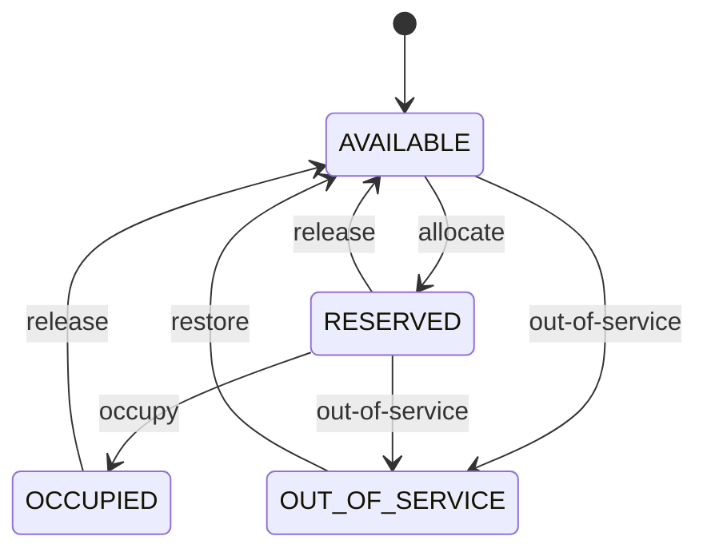

# Smart Locker

REST backend for parcel locker compartment allocation and lifecycle management built with Java 21, Spring Boot, PostgreSQL, and Flyway.

## Overview

The service manages parcel locker compartments across their lifecycle (`AVAILABLE`, `RESERVED`, `OCCUPIED`, `OUT_OF_SERVICE`), enforces valid state transitions inside the `LockerCompartment` domain entity, and uses JPA optimistic locking (`@Version`) to prevent concurrent double-allocation of the same compartment.

## Compartment State Machine



## Tech Stack

- Java 21, Spring Boot 4.1.1 (WebMVC, Data JPA, Validation)
- PostgreSQL + Flyway (`ddl-auto=validate`, `open-in-view=false`)
- JUnit 5, AssertJ, Testcontainers (PostgreSQL), REST-Assured
- Docker & Docker Compose

## API Endpoints

Base path: `/api/v1`

| Method | Endpoint | Description |
| :--- | :--- | :--- |
| `POST` | `/compartments` | Register a compartment in a locker |
| `GET` | `/compartments/{id}` | Get compartment details by UUID |
| `POST` | `/lockers/{lockerIdentifier}/allocations` | Reserve the first available compartment of a given size |
| `POST` | `/compartments/{id}/allocate` | Reserve a specific compartment |
| `POST` | `/compartments/{id}/occupy` | Mark reserved compartment as occupied |
| `POST` | `/compartments/{id}/release` | Release compartment back to `AVAILABLE` |
| `POST` | `/compartments/{id}/out-of-service` | Put compartment into maintenance |
| `POST` | `/compartments/{id}/restore` | Restore compartment from maintenance |
| `GET` | `/lockers/{lockerIdentifier}/compartments` | List compartments (optional `?status=` query parameter) |
| `GET` | `/lockers/{lockerIdentifier}/summary` | Get compartment counts grouped by status |

Error responses use Spring's RFC 7807 `ProblemDetail` (`400` for validation errors, `404` when a compartment is not found, `409` for invalid state transitions, duplicate compartment numbers, or optimistic lock conflicts).

## Running Locally

### Prerequisites

- Java 21+
- Docker (required for Testcontainers and Compose)

### Run Tests

Runs unit tests, Flyway schema migration, REST-Assured integration tests, and the multi-threaded `@Version` concurrency test against PostgreSQL in Testcontainers:

```bash
./mvnw test
```

### Run with Docker Compose

Starts PostgreSQL and builds/starts the application on `http://localhost:8080`:

```bash
docker compose up --build
```
